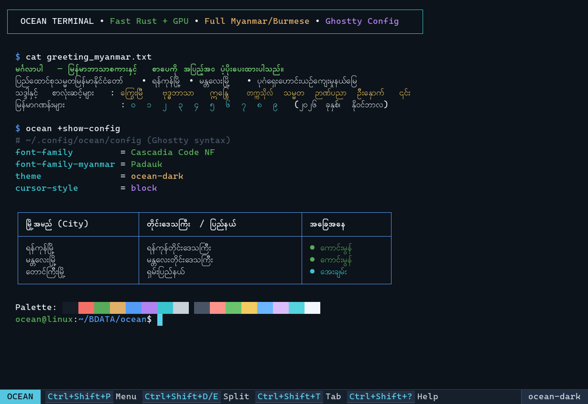
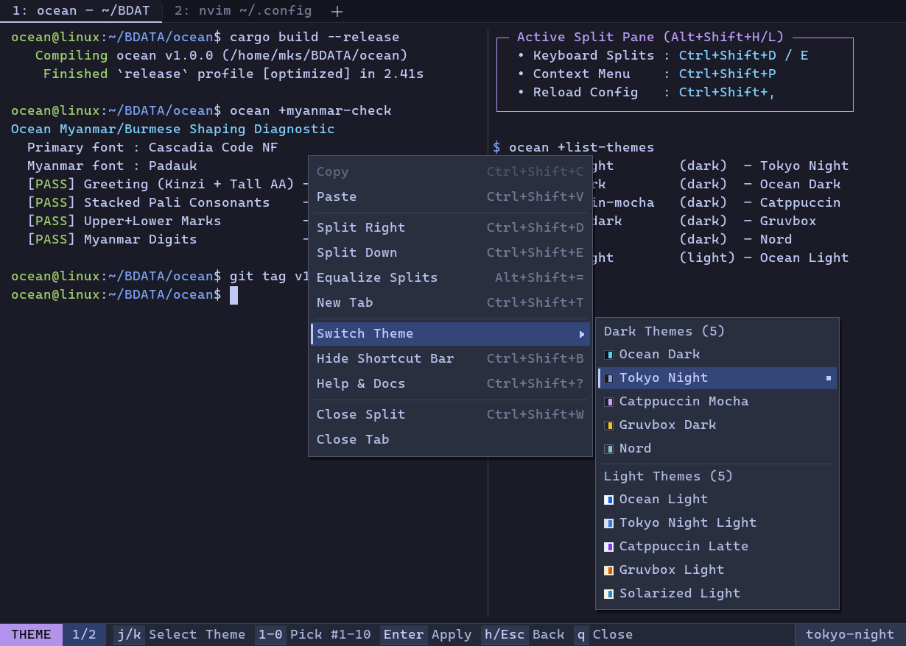
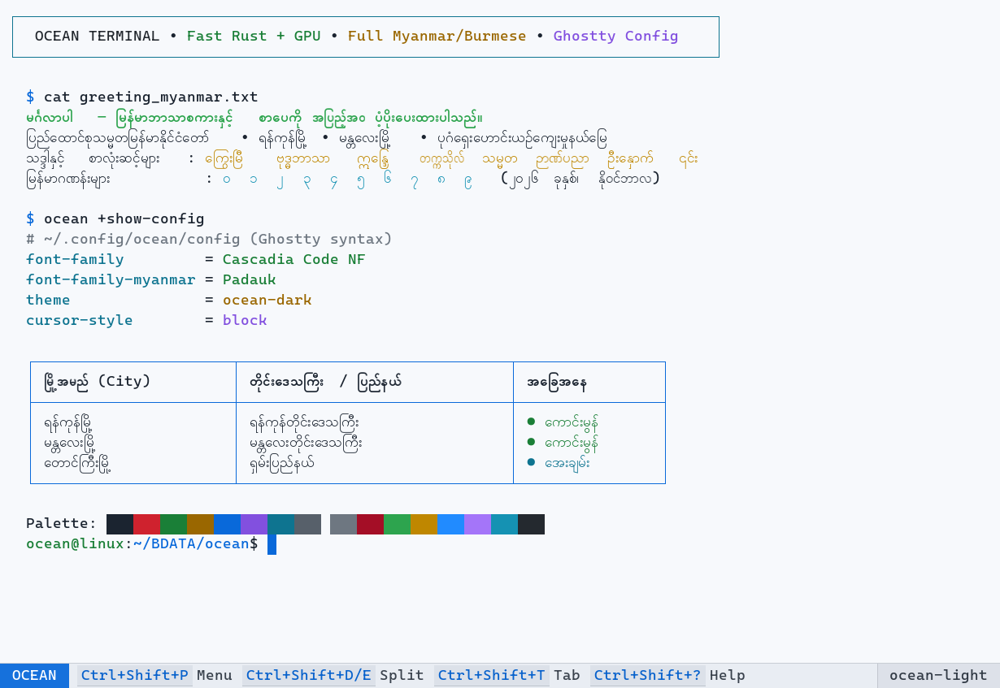

<div align="center">


# Ocean Terminal (`ocean`)

**Clean, minimal, ultra-lightweight GPU-accelerated terminal emulator written in Rust with full Myanmar / Burmese (`မြန်မာဘာသာ`) OpenType shaping support and Ghostty-style configuration.**

[](https://github.com/moekyawsoe/ocean/releases)
[](./LICENSE)
[-38bdf8.svg?style=flat-square)](https://github.com/moekyawsoe/ocean)

[Landing Page Website](./website/index.html) • [Download (.deb / .rpm)](#download--installation) • [Highlights](#highlights) • [CLI Actions](#ghostty-style-cli-actions) • [Config](#configuration-configoceanconfig) • [Shortcuts](#default-shortcuts)

</div>

---

## Screenshots

### 1. Ocean Dark Theme & Native Myanmar (`mym2`) OpenType Shaping


### 2. Side-by-Side Split Panes, Tabs & Vim-Navigable Theme Context Menu


### 3. Ocean Light Theme (High Contrast)


---

## Download & Installation

Pre-built `.deb`, `.rpm`, and portable `.tar.gz` packages are built automatically by GitHub Actions on every tag push (e.g. `v1.0.0`).

### Debian / Ubuntu / Linux Mint / Pop!_OS (`.deb`)

```bash
# Download and install the latest .deb package
curl -LO https://github.com/moekyawsoe/ocean/releases/latest/download/ocean_amd64.deb
sudo apt install ./ocean_amd64.deb
```

### Fedora / RHEL / Rocky Linux / openSUSE (`.rpm`)

```bash
# Install directly via DNF
sudo dnf install https://github.com/moekyawsoe/ocean/releases/latest/download/ocean.x86_64.rpm
```

### Build from Source (Cargo)

```bash
git clone https://github.com/moekyawsoe/ocean.git
cd ocean
cargo build --release
./target/release/ocean
```

---

## Highlights

- **Built-in GPU-Accelerated IDE & Code Editor (`edit [path]` or `ocean edit [path]`)**:
  - **Invocable Everywhere**: Launch directly via standalone `edit [path]`, `ocean edit [path]`, right-click context menu, or keyboard shortcuts (`Ctrl+Shift+I` toggles Pure Editor mode; `Ctrl+\` toggles Split Mode with Editor on top and Terminal on bottom). Typing `edit` (or `ocean edit`) with no arguments automatically opens the current path folder.
  - **Switches the current window, not a new one**: Running `edit [path]` inside an Ocean shell sends a local IPC request to the owning window and switches that pane's window into editor mode. When invoked from outside Ocean, it reuses the most recently active Ocean window if one is running; otherwise it opens a normal editor window.
  - **Unsaved-work protection**: Closing a dirty document, closing the last tab/pane, quitting the app, or pressing the window close button opens a Save / Discard / Cancel confirmation dialog. `:q`, `:wq`, `Ctrl+W`, tab close buttons, and the palette all share the same protection. `:q!` and explicit Discard remain the only ways to drop work.
  - **Compact status bar**: The bottom Neovim-style status bar renders at 80% of the terminal font size by default, keeping shortcut chips readable without dominating the window.
  - **Theme-aware icon system**: Embedded 1×/2× PNG icons are packed into the existing GPU glyph atlas, so activity-bar, file-type, tab, chevron, severity, and toolbar icons stay crisp and tinted by the active theme without adding a second draw call.
  - **Top menu bar & recent files**: `File / Edit / View / Go / Help` menus (F10 or mouse) with recent files, quick open, find, view toggles, and editor/terminal split actions.
  - **Plugin manager**: Plugin manifests and registry, local/URL installation with SHA-256 verification, enable/disable, uninstall, update, checksum verification, and a Plugins sidebar panel. CLI: `ocean +plugin-list`, `+plugin-install`, `+plugin-remove`, `+plugin-enable`, `+plugin-disable`, `+plugin-info`, `+plugin-verify`, `+plugin-update`.
  - **Session restore & crash recovery**: Open documents, cursor/scroll positions, editor mode, and workspace are restored on launch. Dirty/untitled buffers are snapshotted every 15 seconds to `$XDG_STATE_HOME/ocean/backups/` and recovered after a crash; clean exits clear the backups.
  - **Interactive File Explorer Sidebar (`Ctrl+B`)**: Displays the active workspace folder tree with expandable directories and clickable files. Single-click opens any file immediately; click or drag divider to resize; toggle anytime with `Ctrl+B`.
  - **Native OpenGL Pipeline**: Renders directly on Ocean's instanced Glow/OpenGL quad renderer and Winit event loop — no external TUI abstractions (`crossterm`/`ratatui`) required.
  - **First-Class Myanmar Unicode Shaping**: Complex syllables with Virama (`U+1039`), Kinzi (`U+1004 U+103A U+1039`), medials (`U+103B..U+103E`), and combining vowels are unified into grapheme clusters and shaped with `rustybuzz`. Cursor movement locks to composite visual boundaries; backspace/delete removes composite clusters atomically without leaving orphaned diacritics or dotted circles.
  - **High-Performance Buffer**: Powered by `ropey` (B-tree Rope) for O(log N) edits on multi-megabyte files, with full undo/redo transaction stack and position restoration.
  - **Modeless Ergonomics**: Standard developer shortcuts: `Ctrl+S` (Save), `Ctrl+P` (Fuzzy file/command palette powered by `nucleo-matcher`), `Ctrl+F` (Find bar with match navigation), `Ctrl+Z` (Undo), `Ctrl+Y` / `Ctrl+Shift+Z` (Redo), `Ctrl+C` (Copy), `Ctrl+V` (Paste), `Ctrl+X` (Cut), `Ctrl+W` (Close document), and mouse click/drag text selection.
  - **Syntax Highlighting**: Lexical and Tree-sitter tokenizers mapping semantic syntax tokens to Ocean's active color themes across Rust, Python, TypeScript, JavaScript, Go, C/C++, JSON, TOML, Markdown, and Shell.
  - **Embedded Multi-Server LSP Client**: Asynchronous JSON-RPC clients for Rust (`rust-analyzer`), Go (`gopls`), TypeScript/JavaScript (`vtsls` or `typescript-language-server`), Python (`pylsp`/`pyright`), C/C++ (`clangd`), HTML/CSS/SCSS (`vscode-html-language-server` / `vscode-css-language-server`), JSON, YAML, TOML (`taplo`), Shell (`bash-language-server`), and Markdown (`marksman`). Each language gets its own server process, project root, diagnostics, completion popup (`Ctrl+Space`), and hover documentation (`Ctrl+K`).
  - **Sandboxed WASM Plugin Engine**: Embeds `extism` to run sandboxed WebAssembly plugins (`wasm32-wasip1`) loaded from `~/.config/ocean/plugins/`, exposing buffer manipulation, custom command registration, and status bar extensions.
- **Ultra-Lightweight & Fast**: Single-draw-call OpenGL 3.3 / GLES 3.0 instanced GPU renderer (`glutin` + `glow`), shelf-packed `swash` glyph & color emoji atlas, O(1) `FxHashMap` shaped-run memoization, coalesced epoll PTY reader, and **0% idle CPU** (`ControlFlow::Wait`).
- **Full Myanmar / Burmese Support (`U+1000..U+109F`, `U+AA60..U+AA7F`, `U+A9E0..U+A9FF`)**:
  - **HarfBuzz (`rustybuzz`) Run-Based OpenType `mym2`/`mymr` Shaping**: Properly shapes Kinzi (`င်္ဂ`), pre-base vowel `ေ`, medial `ြ ျ ွ ှ` (narrow & wide consonant variants), stacked subjoined consonants (`ဗုဒ္ဓ`, `ဣန္ဒြေ`, `မန္တလေး`, `တက္ကသိုလ်`), tall vs round `ါ`/`ာ` (`ပါ`), `ဦး`, `၎င်း`, and Myanmar digits (`၀-၉`) with **zero dotted circles**.
  - **UTN #11 Combining Order Normalization**: Automatically normalizes swapped typing sequences (e.g. `ကုိ` → `ကို`, `ကေြ` → `ကြေ`) so minor typing-order variations never break syllables.
  - **Vertical Metrics & 2-Layer Compositing**: Upper (`ိ ီ ံ င်္`) and lower (`ု ူ ြ ွ ှ ္`) marks never get clipped by adjacent rows, while procedural box-drawing (`╭─┬─╮`) keeps TUI borders razor-sharp.
  - **Full Burmese Input Method (IME) & XKB Support**: Native Wayland (`zwp_text_input_v3`) & X11 (`XIM`) IME support with live shaped Burmese preedit overlay at the cursor, plus XKB `mm` layout & Wayland/X11 UTF-8 clipboard support.
  - **Optional Legacy Zawgyi-One Display Mode**: Set `myanmar-zawgyi = auto` (or press `Ctrl+Shift+M`) to read legacy Zawgyi logs/files seamlessly in Unicode fonts.
- **Keyboard-First Developer Workflow & Neovim-Style Bottom Bar**:
  - Clean bottom mode & shortcut status bar (`OCEAN`, `TUI`, `SCROLL`, `MENU`, `THEME`, `HELP`) showing live context-aware keybindings, active split indicator, and theme pill (toggleable via `Ctrl+Shift+B` or `window-show-status-bar = false`).
  - Open the Context Menu anytime from the keyboard with `Ctrl+Shift+P` (or `Menu` / `Shift+F10`) anchored right at the terminal cursor, and navigate with Vim keys (`j`/`k`, `t` for themes, `1`–`9` quick-picks, single-key mnemonics, `h`/`l`, `Esc`/`q`).
  - Full keyboard split management: focus (`Alt+Shift+H/J/K/L` or `Alt+Shift+Arrows`), resize (`Ctrl+Alt+H/J/K/L` or `Ctrl+Alt+Arrows`), and equalize (`Alt+Shift+=`).
- **Ghostty-Compatible Config (`~/.config/ocean/config`)**:
  - Clean `key = value` syntax — supports `font-family`, `font-size`, `theme`, `background`, `foreground`, `background-opacity`, `palette`, `cursor-style`, `window-padding-x/y`, `adjust-cell-height/width`, `keybind`, `config-file`, and **live hot-reload** on save or `Ctrl+Shift+,` / `Ctrl+Shift+R`.

---

## Ghostty-Style CLI Actions

```bash
# Generate starter Ghostty-style config at ~/.config/ocean/config
ocean +init-config

# List discovered Monospace & Myanmar/Burmese system fonts
ocean +list-fonts

# List built-in color themes (5 Dark + 5 Light)
ocean +list-themes

# Verify Myanmar/Burmese OpenType shaping on your system
ocean +myanmar-check

# Show active resolved configuration
ocean +show-config

# Validate config file syntax
ocean +validate-config

# Launch with a specific theme or command
ocean --theme=catppuccin-mocha
ocean -e htop
```

---

## Configuration (`~/.config/ocean/config`)

See [`config.example`](./config.example) for all available options:

```ini
# Typography
font-family = Cascadia Code NF
font-family-myanmar = Padauk
font-size = 13.5
myanmar-font-scale = 0.96
myanmar-zawgyi = off

# Theme & Appearance (10 curated themes: ocean-dark, tokyo-night, catppuccin-mocha, nord, ocean-light, etc.)
theme = ocean-dark
background-opacity = 0.96
cursor-style = block
window-titlebar = false
window-show-status-bar = true
window-padding-x = 10,10
window-padding-y = 8,8

# Keybindings
keybind = ctrl+shift+p=toggle_context_menu
keybind = ctrl+shift+b=toggle_status_bar
keybind = ctrl+shift+c=copy_to_clipboard
keybind = ctrl+shift+v=paste_from_clipboard
keybind = ctrl+shift+t=new_tab
keybind = ctrl+shift+d=new_split:right
keybind = ctrl+shift+e=new_split:down
keybind = alt+shift+h=goto_split:left
keybind = alt+shift+l=goto_split:right
keybind = ctrl+alt+h=resize_split:left,40
keybind = ctrl+alt+l=resize_split:right,40
keybind = alt+shift+equal=equalize_splits
keybind = ctrl+shift+w=close_surface
keybind = ctrl+shift+comma=reload_config
keybind = ctrl+shift+m=toggle_myanmar_zawgyi
keybind = ctrl+shift+i=toggle_editor
keybind = ctrl+backslash=toggle_split_mode
```

---

## Default Shortcuts

### Terminal & Global Shortcuts

| Shortcut | Action |
|---|---|
| `Ctrl+Shift+I` | Toggle built-in Code Editor (Pure Editor Mode C) |
| `Ctrl+\` | Toggle Split Mode B (Editor Top, Terminal Bottom with mouse-draggable divider) |
| `Ctrl+Shift+P` / `Menu` / `Shift+F10` | Open / close Context Menu at cursor (navigate with `j`/`k`, `t` themes, `1`–`9`, mnemonics) |
| `Ctrl+Shift+B` | Show / hide bottom Neovim-style shortcut bar |
| `Ctrl+Shift+C` / `Ctrl+Insert` | Copy selection to clipboard |
| `Ctrl+Shift+V` / `Shift+Insert` | Paste from clipboard |
| `Ctrl+=` / `Ctrl+-` / `Ctrl+0` | Increase / decrease / reset font size |
| `Ctrl+Shift+T` / `Ctrl+Shift+W` | New tab / close split or tab (tab bar auto-hides when 1 tab) |
| `Ctrl+Shift+D` / `Ctrl+Shift+E` | Split pane right / split pane down |
| `Alt+Shift+H/J/K/L` or `Alt+Shift+Arrows` | Move focus between split panes |
| `Ctrl+Alt+H/J/K/L` or `Ctrl+Alt+Arrows` | Resize active split pane |
| `Alt+Shift+=` | Equalize split pane sizes |
| `Right Click` | Context menu at pointer (also clickable via bottom bar pills) |
| `Ctrl+Shift+?` | Toggle in-app Help & Documentation dialog (`1`–`5` / `h`/`l` sections, `j`/`k`/`g`/`G` scroll) |
| `Ctrl+Tab` / `Ctrl+Shift+Tab` | Next / previous tab |
| `Ctrl+Shift+N` | Open new window |
| `Ctrl+Shift+,` or `Ctrl+Shift+R` | Live reload configuration |
| `Ctrl+Shift+M` | Toggle legacy Zawgyi-One auto-conversion |
| `Shift+PageUp` / `Shift+PageDown` | Scroll history page up / down |
| `Ctrl+Left Click` | Open URL under cursor |
| `F11` | Toggle fullscreen |

### Code Editor Shortcuts (Modeless TTT-Style)

| Shortcut | Action |
|---|---|
| `Ctrl+B` | Toggle File Explorer Sidebar (show / hide project folder tree) |
| `Ctrl+S` | Save current document buffer to disk |
| `Ctrl+P` | Open Command Palette / Fuzzy File Finder (powered by `nucleo-matcher`) |
| `Ctrl+Shift+F` | Open the workspace Search panel (results respect `.gitignore`) |
| `Ctrl+F` | Open in-buffer Find Bar (`Enter` / `Shift+Enter` cycles matches, `Esc` dismisses) |
| `Ctrl+Space` | Trigger asynchronous LSP autocompletion popup (`Up`/`Down` navigates, `Enter`/`Tab` completes) |
| `Ctrl+K` | Show hover documentation popup for symbol under cursor |
| `Ctrl+Z` | Undo last edit transaction with cursor restoration |
| `Ctrl+Y` / `Ctrl+Shift+Z` | Redo previously undone edit |
| `Ctrl+C` / `Ctrl+X` / `Ctrl+V` | Copy / Cut selection / Paste from clipboard |
| `Ctrl+W` | Close current document tab |
| `Alt+Click` | Add an additional cursor at the clicked position |
| `Ctrl+Alt+Up` / `Ctrl+Alt+Down` | Add a cursor on the line above / below |
| `Esc` | Clear additional cursors (or dismiss the active popup) |
| `Mouse Drag on Divider` | Resize Split Mode B (Editor top ratio vs Terminal bottom ratio) |
| `Mouse Click & Drag` | Precise cluster-aware text selection |

#### Workspace Search & Multi-Cursor

`Ctrl+Shift+F` (or the Search icon in the activity bar) opens a workspace-wide search panel. Type a query and press
`Enter`; `Tab` switches to the replace field, and `Ctrl+Enter` asks for confirmation before replacing every match.
Search is case-insensitive by default; click `Aa` for case-sensitive and `W` for whole-word matching. Results are
grouped as clickable `file:line` rows and honor `.gitignore`.

Multi-cursor editing works in the modeless keymap: `Alt+Click` adds a cursor, `Ctrl+Alt+Up`/`Ctrl+Alt+Down` add one
per line, and typing, `Backspace`, `Delete`, paste, and arrow movement apply to every cursor. `Esc` collapses back to
the primary cursor. The status bar reports the active cursor count.

### Optional Vim Keybindings

Set `editor-keymap = vim` in `~/.config/ocean/config` (live-reloads with `Ctrl+Shift+,`). Ocean then uses modal editing:

| Mode | Entry | Notes |
|---|---|---|
| `NORMAL` | `Esc` | Motions and operators; block cursor |
| `INSERT` | `i` `a` `I` `A` `o` `O` | IME/Myanmar input is active only in this mode |
| `VISUAL` / `VISUAL LINE` | `v` / `V` | Charwise or linewise selection |
| `COMMAND` | `:` | `:w`, `:q`, `:wq`, `:q!`, `:<line>` |

| Keys | Action |
|---|---|
| `h j k l`, arrows | Move cursor |
| `w b e`, `0 ^ $`, `gg G`, `{n}G` | Word / line / document motions |
| `d y c` + motion (`dd`, `dw`, `d$`, `dj`, `dk`) | Delete / yank / change |
| `x X p P J r ~` | Character edits, paste, join, replace, toggle case |
| `u` / `Ctrl+r` | Undo / redo |
| `v` … `d/y/c`, `V` … `d/y/c` | Visual char/line operations |
| `/`, `n`, `N` | Search using the find bar |
| `:` + `w/q/wq/q!/<line>` | Save, close, or jump to a line |

### Session & Recovery Configuration

```ini
window-show-menu-bar = true
restore-session = true
crash-recovery = true
autosave-interval = 15
```

Session snapshots live in `$XDG_STATE_HOME/ocean/session.json` (fallback `~/.local/state/ocean`).

### Language Server Setup (optional)

Ocean starts whatever server it finds on `PATH`; if none is installed, editing still works and the status bar shows `LSP: <server> not found`.

```bash
# Rust, Go, C/C++
rustup component add rust-analyzer
go install golang.org/x/tools/gopls@latest
sudo apt install clangd

# TypeScript / JavaScript, HTML, CSS, JSON, YAML
npm i -g vscode-langservers-extracted yaml-language-server
npm i -g vtsls   # or: npm i -g typescript-language-server

# Python, TOML, Shell, Markdown
pip install python-lsp-server
cargo install taplo-cli
npm i -g bash-language-server
cargo install marksman
```